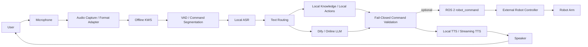

# Voice Control — Multi-Scenario Robot Voice Interaction

> **ROS 2 / MoveIt 2 · Offline KWS / VAD / ASR · Dify / LLM · Local TTS · Speaker Verification · Robot Command Validation**

一个面向真实机械臂场景的语音交互与控制工程。仓库采用 **branch-oriented** 方式管理：不同分支对应不同机械臂、部署平台或演示场景；公共能力围绕“唤醒 → 识别 → 意图路由 → 安全校验 → 语音反馈 → 机器人执行”逐步演进。

这个仓库不是单一 Demo，而是一组已经用于 **机械臂控制、装配演示、展览连续对话、单臂按摩、声纹验证和力值交互** 的工程实现。

---

## Why this project

机器人语音控制真正困难的部分不只是“ASR + LLM”，还包括：

- 嘈杂现场下稳定唤醒，减少误唤醒和 TTS 自激活；
- 不同麦克风采样率、声道和 Linux 音频设备适配；
- 本地知识、固定动作与在线大模型之间的低延迟路由；
- 大模型输出到机械臂动作之间的 **fail-closed Schema 校验**；
- 动作执行确认、持续对话、重复唤醒和播放后的音频缓冲治理；
- 实机功能默认关闭，支持 dry-run、权限开关和外部控制器安全边界；
- 针对按摩等人与机器人接触场景增加身份验证、力度交互和 UI 可视化。

---

## Repository map

> 当前 GitHub 默认分支 `agent/online-voice-dify` 是通用语音架构基线。较新的产品/场景能力主要位于下面两个场景分支。

| Branch | 场景 / 机械臂 | 主要能力 | 推荐阅读 |
|---|---|---|---|
| **[`agent/voice-online-import`](https://github.com/NingXYS/voice_control/tree/agent/voice-online-import)** | **单臂按摩 / x86_64 交付环境** | 按摩点位示教、五级力度、Web UI、声纹验证、力值实时反馈与语音调节、部署验收 | ⭐ 产品化程度最高的按摩场景 |
| **[`huayan-robot-arm`](https://github.com/NingXYS/voice_control/tree/huayan-robot-arm)** | **华沿机械臂 / 装配 / 展览演示** | 装配语音控制、连续对话、重复唤醒、双阶段唤醒验证、流式 TTS、展会抗噪调优 | ⭐ 机械臂 + 展览交互场景 |
| **`agent/online-voice-dify`** | 通用 ROS 2 语音基线 | 离线 KWS、VAD、Paraformer ASR、本地知识、Dify、Kokoro/Piper TTS、ROS 动作发布 | 公共架构与模块边界 |
| `agent/kokoro-female-tts` | TTS 专项 | Kokoro 多语言女声音色、离线 TTS backend | TTS 演进历史 |
| `agent/offline-wake-word` | 离线唤醒专项 | KWS / VAD / ASR / 音频会话稳定化 | 唤醒链路演进历史 |
| `feature/action-execution-ack` | 动作反馈专项 | 动作执行前确认语与回归测试 | 已吸收到后续分支 |
| `feature/mic-capture-adaptation*` | 音频硬件实验 | USB 麦克风采集格式和 ALSA 适配实验 | 历史实验分支 |
| `main` | 初始 ROS 2 / MoveIt 基线 | C++ robot controller + 基础语音控制 | 最小历史基线 |

---

## System architecture



公共语音状态机包含待唤醒、等待说话、录音、处理、播报和停止状态；华沿场景进一步增加连续会话的 `FOLLOWUP_LISTENING`。提示音和 TTS 播放后会清理麦克风残留 PCM、执行 guard，并重置 KWS/VAD，降低机器人“听见自己”造成的误触发。

---

## Featured scenario 1 — Massage robot

分支：`agent/voice-online-import`

该分支已经从最初的在线语音迁移包发展成单臂按摩交互系统。

### Massage workflow

- 支持左肩、右肩、背部、左腰、右腰等示教点位；
- 支持“很轻 / 轻一点 / 适中 / 重一点 / 很重”等五级力度；
- 开始按摩前复述并锁定位置和力度参数；
- 支持状态查询、开始确认、停止与背景音乐；
- 真机执行与语音系统解耦，动作权限默认关闭。

### Speaker verification

声纹链路支持 `off / shadow / enforce` 三种模式：

- `shadow`：记录识别结果但不阻断动作，用于现场数据评估；
- `enforce`：在 ASR / 动作执行前拦截未通过身份验证的用户；
- 支持多用户登记、历史数据归档、候选模型评估与回滚；
- 模型评估包含 FAR、FRR 和 P95 延迟门槛，避免“只看单次相似度”。

声纹属于操作权限辅助层，不代替实体急停，也不防御授权用户录音回放。

### Force-control UI

`VoiceUi/` 将语音交互接入现有 Linux 力控程序：

- 支持“力度调到 10 牛顿”“重一点”“减 3 牛顿”“查询力度”等受限口语；
- 目标力范围按控制程序约束为 **2–70 N**，越界拒绝而不是静默裁剪；
- 保留原控制器 **3 N/s** 斜坡逻辑；
- UI 可同时显示请求目标、斜坡目标、控制反馈和误差曲线；
- 语音桥只允许 status / force / adjust，不开放上电、启动和复位；
- 网络、鉴权、反馈过期、故障和进程生命周期均有独立回归测试。

这部分体现了项目从“语音命令”向“**语音 + 实时控制反馈 + 安全边界**”的扩展。

---

## Featured scenario 2 — Huayan robot arm / exhibition

分支：`huayan-robot-arm`

该分支针对华沿机械臂、装配和展览现场做了专项适配：

- 机械臂产品知识与本地意图扩展；
- 装配语音控制与 dry-run 测试；
- 多轮持续会话：一次唤醒后可继续说话，无需每轮重复唤醒；
- 支持“退出 / 再见”等显式结束会话；
- 对重复唤醒词和 ASR 同音误识别做归一化；
- 低阈值 KWS 候选可进入二级唤醒验证，高置信候选直接通过；
- 针对展览环境优化首字吞音、重复唤醒、环境人声与 TTS 回灌问题；
- 增加流式文本分段和 TTS 路径，降低长回复的体感延迟。

---

## Core modules

```text
voice_control/
├── scripts/
│   ├── voice_wake_entry.py        # runtime entry
│   ├── voice_wake_runtime.py      # wake / VAD / turn state machine
│   ├── voice_audio_session.py     # persistent microphone session
│   ├── voice_capture_adapter.py   # sample-rate / channel conversion
│   ├── voice_audio_frontend.py    # passthrough / basic / NS frontend
│   ├── voice_asr_backend.py       # local ASR backend
│   ├── voice_text_pipeline.py     # local-first routing
│   ├── voice_dialogue_backend.py  # Dify workflow backend
│   ├── voice_command_validation.py# strict command schema
│   ├── voice_robot_executor.py    # ROS 2 command publisher
│   ├── voice_tts.py               # local TTS
│   └── ...
├── knowledge_base/                # robot-specific local knowledge
├── models/                        # KWS / VAD / ASR / TTS assets
├── tests/                         # unit & regression tests
└── docs/                          # architecture and engineering notes
```

更多架构细节见 [docs/architecture.md](docs/architecture.md)。

---

## Safety by design

LLM 或 Dify 的输出不会直接驱动机械臂。

允许的动作必须先经过严格 Schema 校验。例如通用基线只接受：

```text
home
get_status
move_joint
move_cartesian
```

校验原则：

- action 白名单；
- arm 白名单；
- 字段集合必须完全匹配；
- 数值必须有限；
- 不自动补字段、不猜默认值、不修复危险参数；
- 命令批次中任意一项非法，整批拒绝；
- 发布前再次校验；
- 真机执行开关默认关闭。

语音层不替代机器人控制器的关节限位、速度限制、工作空间、碰撞检测、急停和功能安全。

---

## Audio & wake engineering

项目对现场语音问题做了较多工程化处理：

- USB 麦克风 48 kHz / stereo → 16 kHz / mono 格式适配；
- ALSA / PulseAudio / PipeWire 设备诊断；
- KWS 参数扫描与离线评测；
- VAD pre-roll，减少首字被截断；
- TTS 后清空采集缓存；
- post-TTS guard；
- 重置唤醒器，降低扬声器回声误唤醒；
- 展览场景连续会话与二级唤醒验证；
- 按摩力度短句使用独立的短时 VAD 参数。

默认唤醒词为“小西小西 / 小溪小溪”系列配置，具体以对应分支环境变量和模型关键词文件为准。

---

## Tech stack

| Area | Technologies |
|---|---|
| Robotics | ROS 2 Humble, MoveIt 2, TF2, `rclpy` / `rclcpp`, JSON command bridge |
| Voice AI | sherpa-onnx KWS, Silero VAD, Paraformer ASR, Kokoro / Matcha / Piper TTS |
| LLM / Agent | Dify Workflow, local intent routing, robot knowledge base |
| Audio | ALSA, PulseAudio / PipeWire, PCM processing, resampling, noise-suppression frontend |
| Security / Safety | fail-closed schema validation, dry-run defaults, speaker verification, permission gates |
| UI / Integration | Python Web UI, WebSocket events, Linux C++ force-control bridge |
| Engineering | Python, C++, CMake, colcon, unittest / pytest-style regression tests |

---

## Quick start — baseline branch

> 场景分支有自己的部署文件。下面仅用于 `agent/online-voice-dify` 通用基线。

```bash
git clone https://github.com/NingXYS/voice_control.git
cd voice_control
git checkout agent/online-voice-dify
```

环境建议：

- Ubuntu 22.04
- ROS 2 Humble
- Python 3.10
- `python3.10-venv`
- `colcon`
- ALSA tools

构建独立在线 overlay：

```bash
bash scripts/setup_voice_wake.sh
```

启动前检查：

```bash
export DIFY_API_KEY="..."
bash scripts/run_voice_wake.sh --check
```

启动：

```bash
bash scripts/run_voice_wake.sh
```

---

## Testing & diagnostics

常用诊断入口：

```bash
bash scripts/run_voice_wake.sh --check
python3 scripts/voice_capture_smoke.py --probe-only
python3 scripts/voice_capture_smoke.py --seconds 5
python3 scripts/kws_sweep.py --help
```

测试覆盖重点包括：

- 音频采集与格式适配；
- KWS / VAD / 首字保留；
- 唤醒状态机与重复唤醒；
- Dify 路由和本地知识优先；
- 动作 Schema 与批次拒绝；
- 动作执行确认；
- 持续会话；
- 装配控制；
- 声纹验证；
- 按摩和力度 UI / bridge；
- 进程退出与资源清理。

---

## Engineering notes

- [Architecture](docs/architecture.md)
- [Branch evolution](docs/branch-history.md)
- 各场景分支还包含部署计划、演示话术、迁移验收和专项测试文档。

---

## Resume-oriented highlights

如果你是从简历进入这个仓库，建议重点查看：

1. **`agent/voice-online-import`**：单臂按摩、声纹权限、力值语音调节和实时 UI；
2. **`huayan-robot-arm`**：机械臂装配、展览连续对话、双阶段唤醒；
3. **`agent/online-voice-dify`**：公共语音架构、严格命令校验和 ROS 2 接口。

这三个方向分别体现了 **Human-Robot Interaction、Voice/LLM Engineering、Robot Safety Integration** 三类能力。

---

## License

`package.xml` 当前声明 BSD。若作为公开作品集长期维护，建议在根目录补充完整 `LICENSE`，并分别核对第三方模型、SDK 和数据集许可证。
