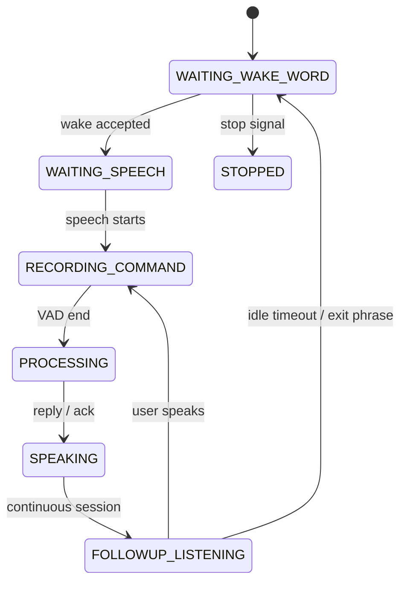
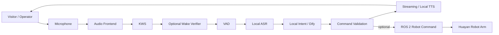

# Huayan Robot Arm Voice Interaction

> **ROS 2 / MoveIt 2 · Offline Wake Word · Continuous Dialogue · Assembly Voice Control · Streaming TTS · Exhibition HRI**

这是 `voice_control` 仓库中面向 **华沿机械臂、装配演示和展览交互** 的场景分支。

该分支从通用语音控制链路继续演进，重点解决真实展览环境中的连续对话、重复唤醒、首字吞音、环境人声、长回复延迟，以及机械臂装配动作的语音接入问题。

---

## Highlights

- 华沿机械臂语音控制适配；
- 装配任务语音控制与 dry-run 验证；
- 一次唤醒后的持续多轮会话；
- 显式“退出 / 再见”结束连续会话；
- 高置信 KWS 直通 + 低置信候选二级验证；
- 对“小西 / 小溪 / 小喜 / 小希”等 ASR 同音误识别归一化；
- 提示音 / TTS 后残留音频清理，降低自唤醒；
- 展会环境抗噪、重复唤醒与首字保留优化；
- 文本分段与流式 TTS，改善长回复首声延迟；
- 本地机器人知识、Dify 在线问答与机械臂动作路由；
- 机械臂动作 Schema 校验和执行权限开关。

---

## Voice state machine



与通用基线相比，本分支增加了 `FOLLOWUP_LISTENING`，使一次唤醒后可以继续多轮交流。

---

## Two-stage wake verification

唤醒链路支持两级判断：

```text
KWS candidate
├── high confidence → accept directly
└── low confidence  → second-stage verifier
                       ├── accepted → enter dialogue
                       └── rejected → reset KWS
```

目的不是单纯降低阈值，而是在展览环境中同时兼顾：

- 远距离和轻声唤醒召回率；
- 环境人声造成的误触发率；
- 重复唤醒后的状态恢复；
- TTS 尾音和回声污染。

---

## Continuous dialogue

一次成功唤醒后，系统可在设定的 session timeout 内继续监听下一句话，无需重复唤醒。

支持结束语：

```text
退出
结束对话
结束会话
再见
不用了
停止聊天
停止对话
```

如果命令 ASR 只识别到唤醒词本身，系统会回复“我在”，而不是把唤醒词错误地送入机械臂 NLU。

---

## Assembly voice control

装配能力位于：

```text
scripts/voice_assembly_controller.py
scripts/assembly_smoke_dryrun.py
tests/test_assembly_command.py
```

设计原则：

- 语音解析与真实机械臂执行解耦；
- 默认 dry-run；
- 参数必须通过本地验证；
- 只有显式开启对应功能开关后才允许进入实机执行路径；
- 机器人底层继续负责运动学、限位、碰撞和急停。

---

## Architecture



---

## Key modules

| Module | Purpose |
|---|---|
| `voice_wake_runtime.py` | continuous-session state machine |
| `voice_wake_verifier.py` | second-stage wake verification |
| `voice_wake_word.py` | KWS and candidate generation |
| `voice_command_vad.py` | command endpointing |
| `voice_text_pipeline.py` | local-first routing |
| `voice_local_knowledge.py` | robot knowledge and deterministic commands |
| `voice_dialogue_backend.py` | online dialogue / Dify |
| `voice_text_segmenter.py` | streaming text segmentation |
| `voice_tts.py` | local / streaming TTS |
| `voice_assembly_controller.py` | assembly task orchestration |

---

## Exhibition-oriented engineering

该分支不是只针对实验室安静环境调参，而是专门处理展览交互中的工程问题：

- 多人环境下的误触发；
- 用户说话距离变化；
- 唤醒后首字被截断；
- 播报声音进入麦克风；
- 用户重复说唤醒词；
- 长回复导致等待感明显；
- 一轮问答结束后还希望继续追问。

因此重点不只是模型准确率，还包括 **audio lifecycle、状态机、buffer cleanup、session timing、回归测试和现场可恢复性**。

---

## Safety

机器人动作默认应保持关闭，直到：

- 动作 JSON / 参数通过校验；
- ROS 2 控制链路正常；
- 工作空间和关节限制已确认；
- 操作者在场；
- 实体急停可用。

语音系统不承担机械臂功能安全职责。

---

## Tech stack

- ROS 2 Humble
- MoveIt 2
- Python / C++
- sherpa-onnx KWS
- Silero VAD
- Paraformer ASR
- Kokoro / Matcha / Piper TTS
- Dify Workflow / online LLM
- ALSA / PulseAudio
- pytest / unittest regression tests

---

## Related branches

- [`agent/voice-online-import`](https://github.com/NingXYS/voice_control/tree/agent/voice-online-import) — massage robot, speaker verification and force-control UI
- [`agent/online-voice-dify`](https://github.com/NingXYS/voice_control/tree/agent/online-voice-dify) — common voice architecture baseline

---

## Resume summary

**Built and iterated a ROS 2 robot voice interaction stack for exhibition and assembly scenarios, including offline wake-word detection, continuous dialogue, two-stage wake verification, streaming TTS, local/LLM intent routing, and validated robot-command execution.**
