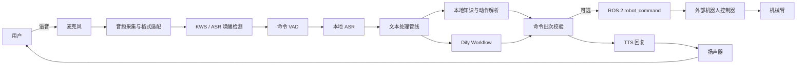
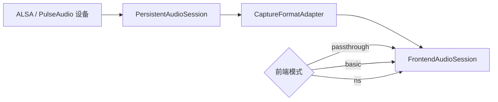
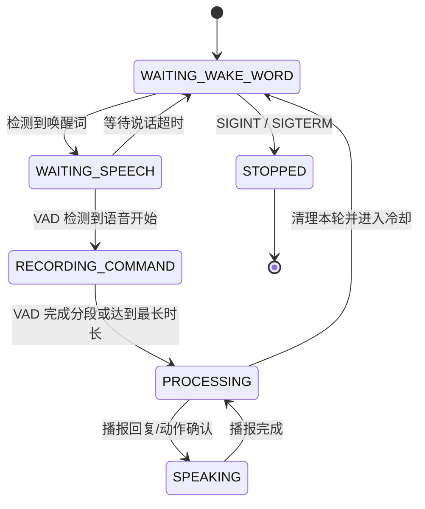
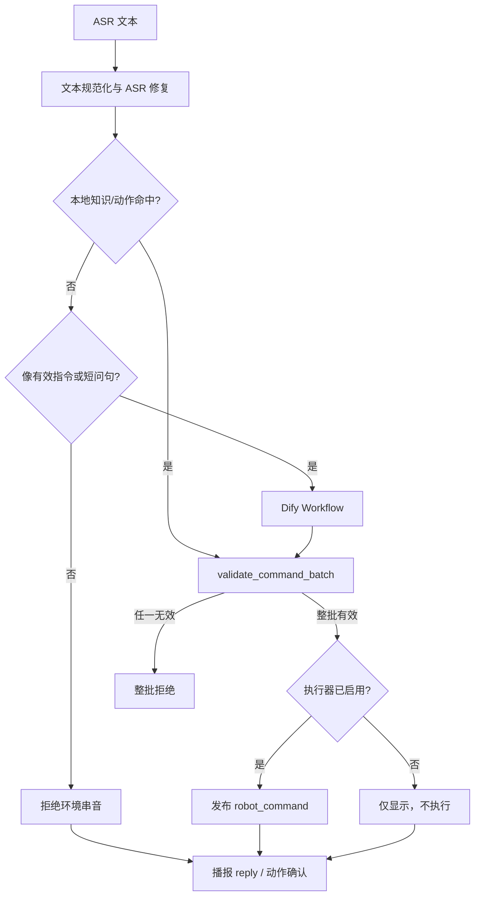
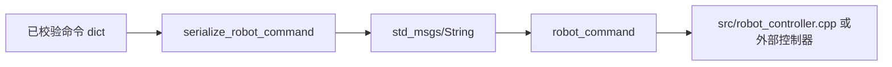
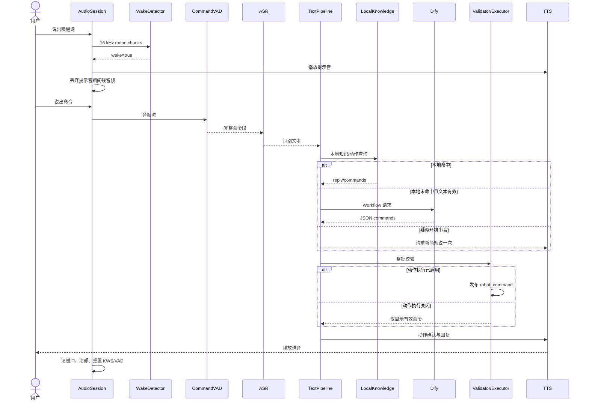

# Voice Control 架构说明

本文描述 `agent/online-voice-dify` 分支的当前架构、模块边界、运行时数据流和安全约束。

> 适用基线：2026-08-05 的 `agent/online-voice-dify`。其他分支可能增加 Web UI、按摩、装配或迁移验收模块，详见 [`branch-history.md`](branch-history.md)。

## 1. 架构目标

该系统把机器人语音交互拆分为可独立测试的层次：

1. 硬件音频采集与格式适配。
2. 离线唤醒与命令语音分段。
3. 本地 ASR。
4. 本地优先的文本路由。
5. Dify Workflow 在线兜底。
6. 输出 Schema 校验。
7. TTS 播报与可选 ROS 2 动作发布。

核心设计原则：

- **唤醒和识别尽量离线。** 网络异常不应破坏麦克风、KWS、VAD 和 ASR 的基本运行。
- **本地优先。** 已知机器人知识与明确动作优先在本地处理，减少延迟和在线依赖。
- **执行默认关闭。** 未显式启用机器人动作时，只解析和显示指令，不执行。
- **校验失败即拒绝。** 不自动修补、补默认值或猜测运动参数。
- **运行时解耦。** ASR、TTS、Dialogue 和 Executor 通过容器装配，便于单测和替换。
- **音频回路隔离。** 提示音和 TTS 播放后丢弃麦克风残留帧并重置 KWS，降低自唤醒。

## 2. 系统上下文



边界说明：

- 本仓库的语音运行时负责产生经过校验的命令 JSON。
- `robot_command` 的订阅方负责真实运动规划与执行。
- 关节限位、工作空间、碰撞检测、急停和人员安全不属于语音模块职责，必须由外部控制系统实现。

## 3. 运行时进程与构建边界

默认在线语音环境使用独立目录：

```text
.venv_online/    Python 3.10 虚拟环境
build_online/    colcon 构建中间产物
install_online/  ROS 2 overlay
log_online/      colcon 日志
```

主要脚本：

| 文件 | 职责 |
|---|---|
| `scripts/setup_voice_wake.sh` | 创建隔离 Python 环境、安装依赖、构建在线 overlay |
| `scripts/run_voice_wake.sh` | 清理污染环境、加载 ROS 2 和 overlay、校验模型/配置、启动入口 |
| `scripts/voice_wake_entry.py` | 装配运行时、音频会话、唤醒器和状态机 |
| `scripts/voice_runtime_container.py` | 创建 ASR、TTS、Dify、机器人执行器并管理生命周期 |
| `scripts/voice_wake_runtime.py` | 单轮语音状态机与音频缓冲治理 |

在线 overlay 默认通过以下 CMake 参数关闭 C++ 机器人控制器：

```text
-DVOICE_CONTROL_BUILD_ROBOT_CONTROLLER=OFF
```

目的不是删除控制器，而是避免在线语音依赖和机器人主工作空间相互污染。真实机器人控制器应在对应机器人工作空间单独构建。

## 4. 核心模块

### 4.1 音频采集层



组件：

| 模块 | 责任 |
|---|---|
| `voice_audio_session.py` | 持续读取麦克风，避免每轮反复打开设备 |
| `voice_capture_adapter.py` | 把硬件采样率和声道数转换为 16 kHz 单声道 |
| `voice_audio_frontend.py` | passthrough、基础增益或降噪前端 |
| `voice_capture_smoke.py` | 设备探测、释放占用、录音和格式诊断 |

典型硬件输入：

```text
UGREEN MIC-CM581: 48 kHz / 2 channels
                       ↓ CaptureFormatAdapter
语音算法统一输入:      16 kHz / mono / float32
```

关键环境变量：

```bash
AUDIO_DEVICE
AUDIO_CAPTURE_SAMPLE_RATE
AUDIO_CAPTURE_CHANNELS
AUDIO_CHUNK_MS
VOICE_AUDIO_FRONTEND
VOICE_DEBUG_AUDIO
VOICE_DEBUG_AUDIO_DIR
```

### 4.2 唤醒与命令录音层

唤醒器有两种实现：

- `WakeWordDetector`：独立 KWS 模型，默认模式。
- `AsrWakeWordDetector`：复用 ASR 模型做窗口匹配，作为备选模式。

唤醒后，`CommandVadDetector` 等待说话开始并收集完整命令段。录音有两个时间边界：

- `COMMAND_START_TIMEOUT_SEC`：唤醒后多久没有开始说话则放弃本轮。
- `COMMAND_MAX_DURATION_SEC`：单条命令最长录音时间。

### 4.3 语音状态机



状态定义位于 `voice_wake_runtime.py`：

```text
WAITING_WAKE_WORD
WAITING_SPEECH
RECORDING_COMMAND
PROCESSING
SPEAKING
STOPPED
```

防回声策略：

1. 播放唤醒提示音后丢弃麦克风缓冲。
2. TTS 播放期间暂停 KWS 输入。
3. TTS 完成后再次丢弃残留帧。
4. 执行 post-TTS guard。
5. 重置 KWS 和 VAD，再恢复监听。

### 4.4 ASR 层

`VoiceRuntimeContainer` 默认创建本地 ASR 后端：

```text
voice_asr_backend.py
  └── LocalASRBackend
        └── 本地 Paraformer / sherpa-onnx 模型
```

入口调用：

```text
WakeWordRuntime
  → asr_callback(audio, 16000)
  → VoiceRuntimeContainer.recognize(...)
  → ASRBackend.transcribe(...)
```

ASR 输出在进入路由前会经过文本修复，例如折叠重复首字或重复短语。

### 4.5 文本处理与路由层



`voice_text_pipeline.py` 的关键顺序：

1. 拒绝空文本。
2. 修复 ASR 重复首字。
3. 调用 `check_local_reply_command()` 查询本地知识或解析本地动作。
4. 本地命中时跳过 Dify。
5. 本地未命中时过滤疑似环境长段串音。
6. 调用 Dify Workflow。
7. 对完整命令批次执行 Schema 校验。
8. 按配置执行动作或仅显示动作。
9. 播放动作确认语和普通回复。

### 4.6 Dify 后端

`DifyWorkflowBackend` 使用阻塞模式调用：

```http
POST {DIFY_BASE_URL}/v1/workflows/run
Authorization: Bearer {DIFY_API_KEY}
Content-Type: application/json
```

请求体结构：

```json
{
  "inputs": {
    "text": "用户文本"
  },
  "response_mode": "blocking",
  "user": "voice_robot"
}
```

输出必须能解析为单个命令对象或命令对象数组。Markdown JSON code fence 会被剥离，但无法解析、字段缺失或类型错误的结果都会被拒绝。

关键环境变量：

```bash
DIFY_BASE_URL
DIFY_API_KEY
DIFY_INPUT_KEY
DIFY_OUTPUT_KEY
DIFY_USER
DIFY_TIMEOUT_SEC
```

### 4.7 命令 Schema

校验模块：`voice_command_validation.py`。

允许的输出类型：

#### 普通回复

```json
{
  "reply": "文本内容"
}
```

回复对象不能附带其他字段。

#### 回零

```json
{
  "action": "home",
  "arm": "left"
}
```

#### 状态查询

```json
{
  "action": "get_status",
  "arm": "right"
}
```

#### 关节运动

```json
{
  "action": "move_joint",
  "arm": "left",
  "joint": 3,
  "value": 10.0,
  "type": "delta"
}
```

约束：

- `joint` 为 1–6 的整数。
- `value` 必须是有限数值。
- `type` 只能是 `delta` 或 `absolute`。

#### 笛卡尔运动

```json
{
  "action": "move_cartesian",
  "arm": "right",
  "x": 0.02,
  "y": 0.0,
  "z": -0.01,
  "relative": true
}
```

约束：

- `x`、`y`、`z` 必须是有限数值。
- `relative` 必须是布尔值。

批次校验采用 fail-closed 策略：任何一项无效，整个数组都不执行。

### 4.8 ROS 2 动作发布层

`ROSRobotExecutor`：

- 创建独立的 `rclpy` Node。
- 固定发布到 `robot_command`。
- 消息类型为 `std_msgs/msg/String`。
- 消息内容为紧凑 JSON。
- 发布前再次调用单命令校验。



启用条件由运行时配置决定。未启用时，解析出的动作仍会显示，便于 dry-run 验收，但不会创建 ROS 发布器。

### 4.9 TTS 层

容器创建 `LocalTTSBackend`，再由 `WakeWordRuntime._reply_speaker()` 包裹播报过程。

```text
文本回复
  → LocalTTSBackend
  → voice_tts.py
  → 本地模型生成 PCM/WAV
  → aplay / 音频播放设备
```

默认分支支持 Kokoro 模型，并保留 Piper 兼容路径。常用参数：

```bash
TTS_MODEL_DIR
TTS_MODEL_FILE
TTS_SPEAKER_ID
TTS_SPEED
TTS_NUM_THREADS
APLAY_DEVICE
VOICE_TTS_TIMING
```

动作 `move_cartesian`、`move_joint`、`home` 被解析后，可先播报简短确认语：

```bash
VOICE_ACTION_ACK_TEXT="好的，正在执行"
```

## 5. 依赖注入与可测试性

`VoiceRuntimeContainer` 统一持有：

```text
asr_backend
tts_backend
dialogue_backend
executor
```

生产环境：

```python
VoiceRuntimeContainer.from_config()
```

测试环境：

```python
VoiceRuntimeContainer.from_local(
    recognizer=fake_recognizer,
    speaker=fake_speaker,
    executor=fake_executor,
    dialogue=fake_dialogue,
)
```

因此测试可以绕过真实模型、Dify、扬声器和 ROS 2，只验证文本路由、状态机与校验规则。

## 6. 一轮交互时序



## 7. 故障与降级行为

| 故障 | 预期行为 |
|---|---|
| `DIFY_API_KEY` 未配置 | 启动时警告；本地链路仍可工作，Dify 请求跳过 |
| Dify HTTP 非 200 | 本轮返回空结果，不执行机器人动作 |
| Dify 输出不是合法 JSON | 本轮拒绝 |
| 命令字段缺失/多余 | 整批拒绝 |
| 机器人执行未启用 | 显示有效动作，不发布 ROS 消息 |
| 麦克风格式不是 16 kHz 单声道 | 由 CaptureFormatAdapter 转换 |
| TTS/提示音进入麦克风缓冲 | 丢弃缓冲、guard、重置 KWS |
| ASR 产生长段环境人声 | 无控制特征时拒绝并提示重说 |
| overlay 过期 | `run_voice_wake.sh --check` 失败并要求重新构建 |
| 模型文件缺失 | 启动前检查失败，不进入运行状态 |

## 8. 安全模型

语音模块提供以下软件边界：

- 动作默认关闭。
- 动作 Schema 白名单。
- 严格字段集合。
- 数值必须有限。
- 批次原子校验。
- 固定 ROS 2 话题。
- 发布前二次校验。

语音模块**没有**提供：

- 速度、加速度和力限制。
- 机械臂工作空间限制。
- 自碰撞或环境碰撞检测。
- 人体接触检测。
- 功能安全等级的停止机制。
- 实体急停。

实机系统必须在机器人控制器或安全 PLC 层实现这些能力。

## 9. 扩展新模块的推荐位置

| 新需求 | 推荐扩展点 |
|---|---|
| 新麦克风或声卡 | `voice_capture_adapter.py` / `voice_capture_smoke.py` |
| 新降噪算法 | `voice_audio_frontend.py` |
| 新唤醒算法 | 实现与 `WakeWordDetector` 相同的 `accept_audio/reset` 接口 |
| 新 ASR | 实现 ASR backend 的 `initialize/transcribe/close` |
| 新 TTS | 实现 TTS backend 的 `speak/close` |
| 新在线平台 | 替换 `dialogue_backend`，保持返回命令对象数组 |
| 新本地技能 | `voice_local_knowledge.py` 和知识库 CSV |
| 新机器人动作 | 同步修改校验 Schema、Dify DSL、控制器和测试 |
| 新 UI | 订阅运行时事件，不要绕过文本校验和执行器 |

新增动作时必须同步更新：

1. `voice_command_validation.py`。
2. Dify Workflow 输出约定。
3. 本地动作解析。
4. 机器人控制器订阅端。
5. 单元测试和 dry-run。
6. 本文档中的 Schema。

## 10. 推荐阅读顺序

新开发者或 AI 建议按以下顺序阅读：

1. 根目录 `README.md`。
2. `scripts/run_voice_wake.sh`。
3. `scripts/voice_wake_entry.py`。
4. `scripts/voice_wake_runtime.py`。
5. `scripts/voice_runtime_container.py`。
6. `scripts/voice_text_pipeline.py`。
7. `scripts/voice_command_validation.py`。
8. `scripts/voice_robot_executor.py`。
9. `scripts/voice_dialogue_backend.py`。
10. [`branch-history.md`](branch-history.md)。
