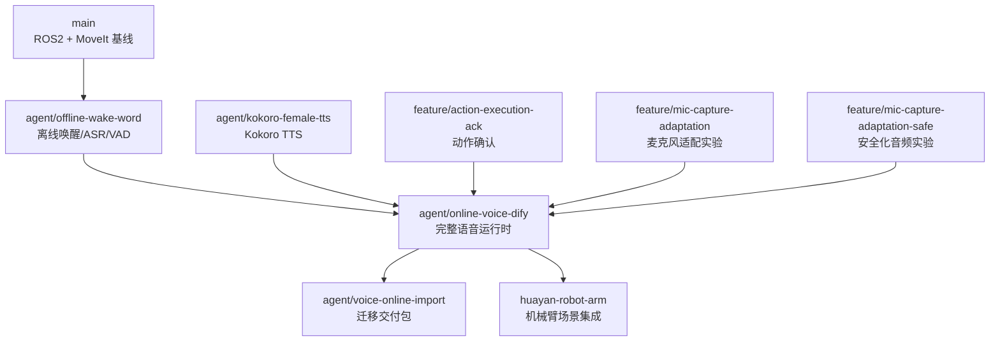

# Branch History

本文记录 `voice_control` 各分支的演进关系和设计目的。

## 总体演进路线



## 1. `main`

定位：项目最初机器人控制基线。

主要内容：

- ROS 2 `ament_cmake` 工程。
- MoveIt 机器人控制入口。
- C++ `robot_controller`。
- 基础语音控制实验。

适合：

- 理解机器人控制底层。
- 查看最小 ROS 2 包结构。

不适合作为当前语音产品部署分支。

原因：

- 缺少完整 KWS/VAD/ASR/TTS 在线运行时。
- 缺少 Dify Workflow 集成。
- 缺少独立在线构建流程。

## 2. `agent/offline-wake-word`

定位：离线语音链路探索阶段。

核心目标：

```text
麦克风
 → 唤醒词
 → VAD
 → ASR
 → 本地处理
 → TTS
```

主要贡献：

- 离线唤醒词检测。
- 语音活动检测。
- 本地 ASR 接入。
- 语音会话循环。
- 启动稳定性修复。

该阶段解决的问题：

- 不依赖云服务完成基础交互。
- 验证机器人端实时语音可行性。
- 建立后续在线语音架构基础。

## 3. `agent/kokoro-female-tts`

定位：语音输出质量专项。

主要内容：

- Kokoro 多语言 TTS。
- 女性音色实验。
- TTS backend 抽象。
- 双运行时测试。

解决的问题：

- 统一不同 TTS 模型调用方式。
- 降低机器人语音播报延迟。
- 支持更自然的人机交互。

最终能力被合并到当前运行时容器设计。

## 4. `feature/action-execution-ack`

定位：动作执行交互体验增强。

主要内容：

- 动作确认语。
- 执行动作后的反馈流程。
- 相关测试。

典型交互：

```text
用户:
移动右臂 10 厘米

系统:
好的，正在执行

ROS:
robot_command
```

该分支解决：

- 用户不知道机器人是否接受指令。
- TTS 延迟和动作反馈体验问题。

能力已进入默认集成分支。

## 5. `feature/mic-capture-adaptation`

定位：硬件麦克风适配实验。

主要关注：

- USB 麦克风采样率差异。
- ALSA 设备变化。
- 声道转换。
- 音频采集稳定性。

后续演化为：

```text
PersistentAudioSession
        ↓
CaptureFormatAdapter
        ↓
AudioFrontend
```

## 6. `feature/mic-capture-adaptation-safe`

定位：更保守的麦克风适配路线。

与上一分支区别：

- 修改范围更小。
- 降低破坏已有语音链路风险。
- 优先保证回归稳定。

最终相关设计被吸收到：

- `voice_capture_adapter.py`
- `voice_audio_session.py`
- `voice_capture_smoke.py`

## 7. `agent/online-voice-dify`

定位：当前主开发分支。

这是目前推荐使用的分支。

集成内容：

```text
离线 KWS
 + VAD
 + ASR
 + 本地知识
 + Dify Workflow
 + TTS
 + 动作解析
 + ROS2 发布
 + 麦克风适配
 + 测试体系
```

关键设计：

### 运行时容器

```text
VoiceRuntimeContainer
    ├── ASR Backend
    ├── TTS Backend
    ├── Dialogue Backend
    └── Robot Executor
```

### 文本处理链

```text
ASR
 ↓
文本修复
 ↓
本地知识优先
 ↓
Dify 兜底
 ↓
Schema 校验
 ↓
执行/播报
```

### 安全执行链

```text
Dify JSON
 ↓
validate_command_batch
 ↓
robot_command
 ↓
机器人控制器
```

## 8. `agent/voice-online-import`

定位：迁移和交付版本。

主要内容：

- Ubuntu 22.04 x86_64 部署。
- 环境模板。
- Dify 部署。
- Web 语音仪表盘。
- migration acceptance 验收记录。
- 模型清单。

适合：

- 新机器部署。
- 展示环境复制。
- 交付客户或现场工程师。

不建议：

- 作为日常 feature 开发分支。

## 9. `huayan-robot-arm`

定位：机械臂专项集成。

主要增加：

- 华沿机器人相关动作。
- 装配场景。
- 更完整的机器人工作流。
- 迁移验证资料。

适合：

- 机械臂现场调试。
- 展会/演示场景。

注意：

该分支增加了更多真实机器人能力，因此必须保持安全边界：

- 默认关闭真实动作。
- 控制器负责限位。
- 现场必须保留急停。

## 当前推荐关系

| 目的 | 分支 |
|---|---|
| 日常开发 | `agent/online-voice-dify` |
| 语音算法研究 | `agent/offline-wake-word` |
| TTS 调优 | `agent/kokoro-female-tts` |
| 部署交付 | `agent/voice-online-import` |
| 机械臂专项 | `huayan-robot-arm` |
| 查看历史设计 | 其他 feature 分支 |

## AI 阅读建议

如果 AI Agent 接管本项目，推荐顺序：

1. `README.md`
2. `docs/architecture.md`
3. `scripts/voice_wake_entry.py`
4. `scripts/voice_runtime_container.py`
5. `scripts/voice_wake_runtime.py`
6. `scripts/voice_text_pipeline.py`
7. `scripts/voice_command_validation.py`
8. 当前分支 commit history
9. feature branch history

不要直接从旧 feature 分支推断当前架构。
