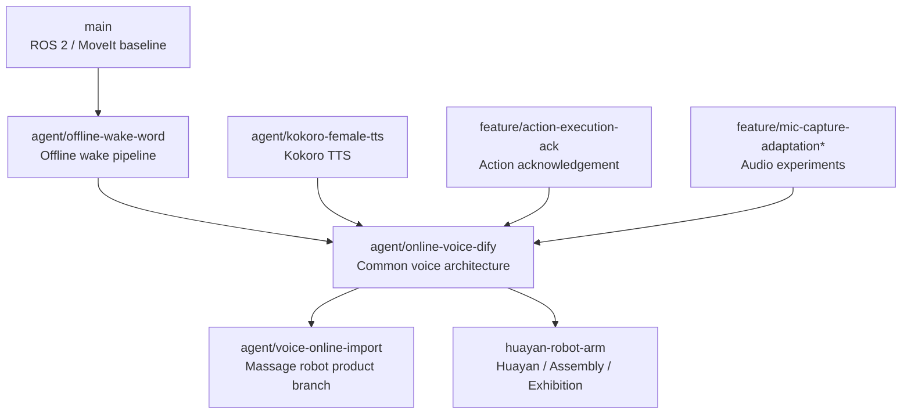

# Branch History & Scenario Map

本文记录 `voice_control` 各分支的演进关系。由于项目采用“一个仓库、多机械臂 / 多场景分支”的方式维护，阅读时应优先理解**当前场景职责**，而不是把所有分支看成线性版本号。

## Current scenario map



> 这张图表达的是“能力来源 / 场景分化”，不是严格的 Git merge DAG。当前两个主要场景分支都已继续独立演进，并与默认分支存在提交分叉。

---

## 1. `main` — ROS 2 / MoveIt baseline

项目最初的机器人控制基线：

- ROS 2 `ament_cmake`;
- MoveIt 机器人控制；
- C++ `robot_controller`;
- 基础语音控制实验。

用途：查看最小机器人控制架构和早期设计，不建议直接作为当前语音产品部署版本。

---

## 2. `agent/offline-wake-word` — Offline wake pipeline

离线语音链路专项：

```text
Microphone
  → KWS
  → VAD
  → ASR
  → local processing
  → TTS
```

主要贡献：

- 离线 KWS；
- VAD；
- 本地 ASR；
- 共享 audio / text pipeline；
- wake runtime 稳定化；
- 回归测试。

该分支奠定后续公共语音架构。

---

## 3. `agent/kokoro-female-tts` — Offline TTS

TTS 专项分支，主要完成：

- Kokoro 多语言离线 TTS；
- 女性音色；
- TTS backend 抽象；
- 可配置模型；
- 音频前端 / TTS 联调。

其主要能力已被后续集成分支采用。

---

## 4. `feature/action-execution-ack` — Action acknowledgement

解决机器人接到控制意图后用户缺少即时反馈的问题。

典型交互：

```text
User: 右臂向上移动 10 厘米
System: 好的，正在执行
Robot: validated action path
```

主要能力：

- 动作确认语；
- 动作解析与播报时序；
- 回归测试。

该能力已进入后续场景分支。

---

## 5. `feature/mic-capture-adaptation*` — Audio hardware experiments

这两条分支用于探索 USB 麦克风和 Linux 音频设备适配：

- 采样率 / 声道转换；
- ALSA plug 适配；
- persistent capture；
- audio frontend；
- debug recording；
- 小范围安全改造和回滚。

后续公共架构形成：

```text
PersistentAudioSession
    ↓
CaptureFormatAdapter
    ↓
AudioFrontend
    ↓
KWS / VAD / ASR
```

这些分支现在主要用于追溯设计过程。

---

## 6. `agent/online-voice-dify` — Common voice architecture

GitHub 当前默认分支，也是公共架构基线。

核心能力：

- offline KWS;
- VAD;
- local ASR;
- local knowledge / deterministic action parsing;
- Dify Workflow;
- local TTS;
- strict command validation;
- optional ROS 2 command publishing;
- audio hardware adaptation;
- isolated Python / colcon online runtime;
- regression tests.

核心模块边界：

```text
VoiceRuntimeContainer
├── ASR Backend
├── TTS Backend
├── Dialogue Backend
└── Robot Executor
```

动作链：

```text
local / Dify output
      ↓
validate_command_batch
      ↓
optional robot_command
      ↓
external robot controller
```

该分支适合阅读公共设计，但**不是所有最新场景功能的合集**。按摩和华沿分支已经在其上继续独立发展。

---

## 7. `agent/voice-online-import` — Massage robot product branch

### Current positioning

这条分支已经不再只是“迁移包”，目前是 **单臂按摩机器人 + 声纹权限 + 力值交互 + Web UI** 的主要产品场景分支。

### Evolution

早期：

- Ubuntu 22.04 x86_64 迁移；
- Dify workflow；
- Web voice dashboard；
- 模型与依赖锁定；
- migration acceptance。

随后增加：

- 单臂按摩点位示教；
- 左肩 / 右肩 / 背部 / 左腰 / 右腰；
- 五级口语力度；
- 开始前参数复述与确认；
- 按摩音乐；
- 按摩停止 / 进程清理修复。

### Speaker verification

2026-08 后继续增加：

- 声纹登记与验证；
- 多用户 profile；
- shadow / enforce 模式；
- CAM++ / ERes2Net 系列候选模型比较；
- FAR / FRR / P95 评估；
- 阈值手动调整；
- 失败后持续唤醒行为；
- active model 原子切换与回滚。

### Force-control UI

2026-10 继续发展：

- Linux 力控桥；
- 语音调节目标力；
- 2–70 N 范围校验；
- 保留 3 N/s 原控制斜坡；
- 请求目标 / 斜坡目标 / 控制反馈实时曲线；
- status / force / adjust 受限接口；
- WebSocket telemetry；
- 网络 / 鉴权 / feedback stale / process cleanup 回归测试；
- 背部穴位展示 UI。

### Recommended use

- 按摩机器人 HRI；
- 人机接触场景；
- 声纹权限研究；
- 力控语音交互；
- 产品化 UI 和部署验收。

---

## 8. `huayan-robot-arm` — Huayan / Assembly / Exhibition

### Current positioning

华沿机械臂、装配和展览交互专项。

### Robot integration

- 华沿机械臂动作适配；
- 本地机器人知识；
- 装配任务控制；
- `voice_assembly_controller.py`;
- assembly dry-run；
- 动作验证测试。

### Exhibition HRI

后续重点转向真实展览环境：

- 连续会话；
- 一次唤醒后 follow-up listening；
- 显式结束会话；
- 重复唤醒处理；
- “小西 / 小溪 / 小喜 / 小希”等同音归一化；
- 展会人声干扰治理；
- 首字保留；
- TTS 回灌缓冲清理。

### Two-stage wake

分支中进一步引入：

```text
KWS candidate
├── high confidence → direct accept
└── low confidence  → wake verifier
                       ├── accepted
                       └── rejected / reset
```

目标是在远场召回率与误唤醒率之间取得更合理的工程折中。

### Streaming response

- 文本分段；
- 流式 / 分句 TTS；
- 长回复首声延迟优化。

### Recommended use

- 华沿机械臂；
- 装配演示；
- 展览 / 军事展示连续对话；
- 现场 HRI 调优。

---

## Current branch selection

| Goal | Recommended branch |
|---|---|
| 阅读公共语音架构 | `agent/online-voice-dify` |
| 按摩机器人 / 声纹 / 力控 UI | **`agent/voice-online-import`** |
| 华沿机械臂 / 装配 / 展览连续对话 | **`huayan-robot-arm`** |
| 离线唤醒算法历史 | `agent/offline-wake-word` |
| Kokoro TTS 历史 | `agent/kokoro-female-tts` |
| 音频 / 动作确认实验历史 | `feature/*` |
| 初始 ROS 2 控制基线 | `main` |

---

## Resume view

如果从作品集 / 简历角度阅读，建议把仓库理解为三层能力：

### 1. Common voice robotics platform

`agent/online-voice-dify`

体现：

- Voice AI pipeline；
- ROS 2 integration；
- local / cloud routing；
- fail-closed action schema；
- audio engineering。

### 2. Physical HRI product scenario

`agent/voice-online-import`

体现：

- massage orchestration；
- speaker authorization；
- force-control interaction；
- Web UI；
- real-time feedback；
- process / deployment engineering。

### 3. Exhibition & assembly interaction

`huayan-robot-arm`

体现：

- robot-specific integration；
- assembly control；
- continuous dialogue；
- two-stage wake verification；
- noisy-environment HRI。

---

## Recommended reading order

1. root `README.md`
2. `docs/architecture.md`
3. this document
4. target scenario branch README
5. `voice_wake_entry.py`
6. `voice_wake_runtime.py`
7. `voice_runtime_container.py`
8. `voice_text_pipeline.py`
9. `voice_command_validation.py`
10. scenario-specific controller / UI

Do not infer current product capability from an old feature branch alone.
