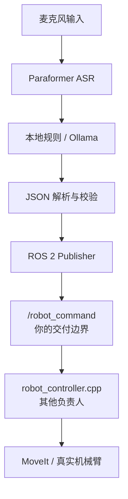

需要修改。你的迁移范围应该收窄为：

> 从麦克风输入开始，到向 ROS 2 发布符合约定的消息为止。
> `robot_controller.cpp`、MoveIt、厂商驱动和真实执行由另一位负责人维护。

你的代码边界已经很明确：[`voice_qwen_llm.py`](https://github.com/NingXYS/voice_control/blob/main/scripts/voice_qwen_llm.py) 把动作 JSON 发布到 `/robot_command`，到这里就算你的功能交付完成。

## 推荐的新边界



## 你负责的内容

* 麦克风录音正常
* Paraformer 识别正常
* 本地固定回复正常
* 本地动作解析正常
* Ollama 模型调用正常
* Dify 移除或关闭
* 模型输出能解析为 JSON
* 不合法输出不会发布
* 动作消息发布到 `/robot_command`
* 回复消息发布到 `/voice_reply`
* 装配数量发布到 `/assembly_count`
* ARM64/Jetson 环境能启动
* 离线模型、Python 依赖能正确加载
* 提供输出接口测试结果

## 你不负责的内容

* 修改 `robot_controller.cpp`
* MoveIt 规划配置
* 机械臂关节限制
* 机械臂以太网通信
* 厂商 ROS 2 驱动
* 机械臂急停和控制器状态
* 真机动作安全
* 机械臂执行成功与否

不过，你仍然需要和执行负责人确认输入协议。否则可能出现“你的 JSON 正确，但对方程序不接受”的情况。

## 第一件事：冻结输出协议

根据当前仓库，接口暂定为：

| 项目        | 当前值                                               |
| --------- | ------------------------------------------------- |
| ROS topic | `/robot_command`                                  |
| 消息类型      | `std_msgs/msg/String`                             |
| 内容格式      | 单条 JSON 对象                                        |
| 距离单位      | 米                                                 |
| 关节角度单位    | 弧度                                                |
| 手臂        | `left` / `right`                                  |
| 动作        | `move_cartesian`、`move_joint`、`home`、`get_status` |

需要让执行负责人书面确认这些 JSON：

```json
{
  "action": "move_cartesian",
  "arm": "left",
  "x": 0.0,
  "y": 0.0,
  "z": 0.1,
  "relative": true
}
```

```json
{
  "action": "move_joint",
  "arm": "right",
  "joint": 1,
  "value": 0.087266,
  "type": "delta"
}
```

```json
{
  "action": "home",
  "arm": "left"
}
```

```json
{
  "action": "get_status",
  "arm": "right"
}
```

还要确认两个问题：

1. 多条动作是连续发布多个 JSON，还是一次发布 JSON 数组？
2. 下一条动作需要等待执行完成，还是允许固定间隔发布？

当前代码是拆成多条消息发布，间隔只有 `0.5` 秒。这一点必须由执行负责人确认，不能由语音端自行假定。

## 迁移方案建议改成“宿主机语音节点 + Ollama 容器”

你暂时不需要把 ROS、语音和执行层全部塞进一个容器。第一版推荐：

| 模块                     | 部署方式             |
| ---------------------- | ---------------- |
| Ollama                 | Jetson ARM64 容器  |
| Qwen 模型                | 挂载到 Ollama 模型目录  |
| 语音 Python 程序           | Jetson 宿主机运行     |
| Paraformer/TTS         | 宿主机模型目录          |
| ROS 2 Publisher        | 宿主机 ROS 2 Humble |
| `robot_controller.cpp` | 由执行负责人部署         |

这样可以避免在语音容器中处理 `rclpy`、DDS、ROS 环境和音频设备的多重兼容问题。等功能完全验证后，再考虑是否容器化语音节点。

## 你需要修改的代码范围

### 1. 消除开发机绝对路径

当前存在：

```python
PARAFORMER_MODEL_DIR = "/home/ning/model/..."
```

以及：

```python
/mnt/ssd/lyz/fastdds_wifi.xml
/mnt/ssd/lyz/install/.../single_point_demo
```

至少把语音模型路径改成环境变量：

```python
PARAFORMER_MODEL_DIR = os.environ.get(
    "PARAFORMER_MODEL_DIR",
    "/opt/voice-control/models/paraformer"
)
```

同样参数化：

* `OLLAMA_BASE_URL`
* `OLLAMA_MODEL`
* `TTS_MODEL_DIR`
* `AUDIO_DEVICE`
* `VOICE_HARDWARE_PROFILE`

### 2. 生产环境关闭 Dify

离线部署时：

```bash
export DIFY_API_KEY=
export OLLAMA_MODEL=qwen2
```

你的 [`voice_llm_client.py`](https://github.com/NingXYS/voice_control/blob/main/scripts/voice_llm_client.py) 在 `DIFY_API_KEY` 为空时会直接走 Ollama，因此不需要迁移 Dify。

### 3. 不再直接启动打招呼程序

当前检测到“你好”等词后，会直接启动：

```text
single_point_demo
```

这已经越过你的语音输出边界，而且路径写死在别人的机器上。

迁移时建议：

* 暂时禁用打招呼动作，只输出语音回复；或者
* 与执行负责人约定一个 ROS topic/service，由你发布“greet”请求。

不要由语音程序直接启动机械臂执行文件。

### 4. 保留 `robot_controller.cpp`，但不修改

它可以继续留在仓库中，作为接口参考。你的离线包不需要负责构建或启动它。

最好把运行流程分开：

```text
你的启动命令：
Ollama + voice_qwen_llm.py

对方启动命令：
机械臂驱动 + MoveIt + robot_controller
```

## 你的离线包应包含什么

```text
voice-model-offline/
├── images/
│   └── ollama-arm64.tar
├── models/
│   ├── ollama/
│   ├── paraformer/
│   └── vits-piper/
├── source/
│   ├── voice_qwen_llm.py
│   ├── voice_llm_client.py
│   ├── voice_local_knowledge.py
│   ├── voice_tts.py
│   └── latency_metrics.py
├── knowledge_base/
├── wheelhouse/
│   └── ARM64 Python wheels
├── config/
│   └── voice.env
├── tests/
│   └── test_local_action_parser.py
├── start-ollama.sh
├── start-voice.sh
├── verify-output.sh
└── SHA256SUMS
```

不需要把这些纳入你的交付验收：

* MoveIt 镜像
* 机械臂驱动
* `robot_controller` 可执行程序
* 机械臂网络配置

## 不连接机械臂也能完成验收

你可以不运行 `robot_controller.cpp`，直接查看你的输出。

终端一：

```bash
source /opt/ros/humble/setup.bash
ros2 topic echo /robot_command std_msgs/msg/String
```

终端二启动语音程序。说：

```text
左臂向上10厘米
```

终端一应该看到类似：

```yaml
data: '{"action": "move_cartesian", "arm": "left", "x": 0, "y": 0, "z": 0.1, "relative": true}'
```

这就证明你的程序已经完成了交付边界内的工作。

还可以模拟订阅：

```bash
ros2 topic info /robot_command --verbose
ros2 topic echo /voice_command
ros2 topic echo /voice_reply
ros2 topic echo /assembly_count
```

## 你的验收测试应分成四层

### 1. 模型和依赖

* Ollama `/api/tags` 可访问
* Qwen 模型已加载
* Paraformer 能加载
* TTS 能播放
* 完全断网后仍能运行

### 2. 文本到 JSON

至少验证：

| 输入             | 期望                         |
| -------------- | -------------------------- |
| 左臂向上10厘米       | `move_cartesian`，`z=0.1`   |
| 右臂关节1旋转5度      | `move_joint`，值约 `0.087266` |
| 左臂向上           | 返回澄清，不发布动作                 |
| 动一下            | 返回澄清，不发布动作                 |
| 你是谁            | `/voice_reply`             |
| 非法或非 JSON 模型输出 | 不发布动作                      |

### 3. 语音到 JSON

用固定录音样本测试：

* 安静环境
* 现场噪声环境
* 左/右臂易混淆语句
* 五厘米/十厘米
* 关节一/关节七
* 否定句，例如“不要移动左臂”

### 4. ROS 输出接口

验证：

* topic 名称正确
* 消息类型正确
* JSON 可解析
* 单位正确
* 字段完整
* 多条命令顺序正确
* 回复不会误发到 `/robot_command`

## 修改后的迁移阶段

1. 与执行负责人确认 ROS topic 和 JSON 合约。
2. 参数化模型路径、Ollama 地址、音频设备。
3. 关闭 Dify，保留 Ollama。
4. 禁止语音代码直接启动 `single_point_demo`。
5. 在 x86 开发机完成文本和单元测试。
6. 准备 ARM64 Ollama 镜像、模型和 Python wheel。
7. U 盘导入 Jetson。
8. Jetson 上先测试 ASR、Ollama、TTS。
9. 不启动机械臂，通过 `ros2 topic echo` 验收输出。
10. 输出协议通过后，由执行负责人接入 `robot_controller.cpp` 做联调。

因此，你不需要承担前面提到的 C++ 安全改造。你的核心目标是：**在 Jetson 完全离线环境中，稳定地把语音转换成经过校验、符合双方约定的 ROS 2 消息，并证明发布端输出正确。**

